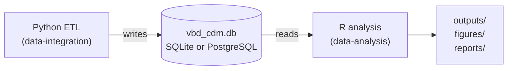
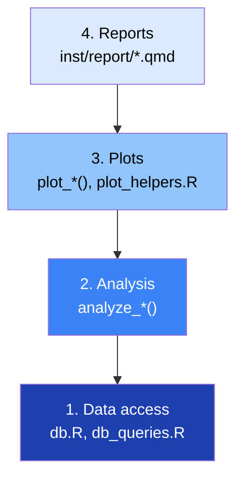

# Architecture

## Data flow



The two projects share **only** the database. They have no shared code,
no shared configuration, and no shared test suite. This is deliberate: it
means the R side can be developed, versioned, and deployed independently
of the Python side, as long as both agree on the schema described in the
CDM contract.

The contract is one-directional in practice: the Python ETL writes it,
the R analysis reads it. The R side never writes to `vbd_cdm.db`.

## Project layout

```
data-analysis/
|-- _targets.R              pipeline definition (see pipeline.md)
|-- config.yml              study configuration (see configuration.md)
|-- DESCRIPTION             package metadata
|-- renv.lock               pinned dependencies
|-- R/
|   |-- config.R            new_analysis_config(), read_cfg(),
|   |                       read_db_block(), resolve_database()
|   |-- db.R                cdm_connect(), cdm_query(), cdm_backend()
|   |-- db_queries.R        all SQL - pure data access, no analysis
|   |-- qa.R                summarize_available_data()
|   |-- analysis_vector_seasonal.R    vector seasonality (primary)
|   |-- analysis_vector_climate.R     vector-climate associations (primary)
|   |-- analysis_resistance.R         insecticide resistance (primary)
|   |-- analysis_bionomics.R          vector bionomics (primary)
|   |-- analysis_seasonal.R           case seasonality (contextual)
|   |-- analysis_glm.R                negative-binomial GLM (scaffold)
|   |-- analysis_dlnm.R               distributed-lag model (scaffold)
|   |-- analysis_inla.R               spatial BYM2 (scaffold)
|   |-- spatial_join.R                grid-cell assignment
|   `-- plot_helpers.R                theme_cdm(), palette, save_plot()
|-- inst/report/
|   |-- analysis_report.qmd           narrative report
|   `-- qa_report.qmd                 data-availability report
|-- outputs/analysis/       created by _targets.R at runtime
|   |-- figures/            PNG outputs from plot_*()
|   |-- data/               qa.rds, analysis_results.rds
|   `-- reports/            rendered HTML
`-- docs/                   this documentation
```

## Layering

The R side has **four layers**, each of which may only depend on the ones
below it:



Each layer has a single responsibility:

- **Layer 1 - Data access.** Knows SQL, knows the schema, knows how to
  connect. Returns tibbles. Contains no statistics, no plotting, no file
  I/O beyond what the DB driver requires.
- **Layer 2 - Analysis.** Pure functions: tibbles in, lists out. Contains
  no SQL, no file I/O, no plotting. This is the layer that makes the
  `targets` cache correct - see *Purity* below.
- **Layer 3 - Plots.** Takes an analysis result plus a study name and an
  output directory, writes PNGs, returns the file paths. No analysis
  logic. No SQL. Uses `theme_cdm()` and `cdm_palette` for visual
  consistency.
- **Layer 4 - Reports.** Quarto documents that render the analysis
  results and embed the figures. No SQL, no analysis, no plotting.

Dependencies point strictly downward. A Layer 2 module that calls into
Layer 3 would break the cache; a Layer 3 module that queries the database
directly would break testability.

## The exception: `spatial_join.R`

`R/spatial_join.R::attach_grid_cells()` violates the layering rule. It
calls `cdm_query()` to fetch location centroids, then joins them to a
vector-observations tibble by nearest-neighbour. Strictly, that makes it
a Layer 1 function that returns a Layer 2-shaped object.

If you want to bring it into compliance, the refactor is small:

1. Move the centroid query into `R/db_queries.R` as
   `query_location_centroids(cfg)`. It should follow the same pattern as
   every other query: take `cfg` and `location_ids`, call
   `cdm_query_cfg()`, and return a tibble with `location_id`,
   `centroid_lat`, `centroid_lon`.

2. Change `attach_grid_cells()` to take the centroids as an argument:

   ```r
   attach_grid_cells <- function(vectors, centroids) { ... }
   ```

3. Wire it in `_targets.R`:

   ```r
   tar_target(location_centroids, query_location_centroids(cfg)),
   tar_target(vectors_with_grid,
              attach_grid_cells(vectors_validated, location_centroids)),
   ```

Until that refactor happens, `attach_grid_cells` is the one documented
exception to the purity rule. Do not add more.

## The `cfg` object

Every layer above Layer 1 receives a `cfg` object - the result of
`new_analysis_config()` in `R/config.R`. It is a plain list with class
`"analysis_config"`. Its fields are the `vbd-cdm-analysis:` block from
`config.yml` plus two fields resolved from the `database:` block:

- `db_path` — a SQLite file path, or `NULL`.
- `db_url` — a full connection URL, or `NULL`.

Exactly one of `db_path` / `db_url` is non-`NULL` per run. That choice is
made by `resolve_database()` at the top of `_targets.R` and is encoded
into the `cfg` object.

`cfg` is passed by value; nothing mutates it. It is hashed by `targets`
as a single object, so **any change to any key in `config.yml`
invalidates every target that reads `cfg`** - which is nearly all of
them, including the extraction queries. See
[Configuration → Config invalidation](configuration.md#config-invalidation)
for the full picture.

The distinction between `cfg` and the rest of the pipeline: `cfg` is
*identity* (which study, which years, which database), not *data*. It
never grows.

## Purity

The cache is the whole reason for the layering rules. `targets` decides
whether to skip a target by hashing:

- the target's command (the R code),
- the value of every other target it reads,
- the value of any global object it references.

It **cannot** see:

- files that a target reads directly,
- database rows that a target queries directly,
- random numbers (unless the seed is a target input),
- time (`Sys.time()`),
- environment variables.

If a Layer 2 function reads a file, calls `cdm_query`, or calls
`Sys.time()`, `targets` will cache a result whose value depends on
something it didn't hash. On the next run, if that external thing has
changed, `targets` won't notice and will silently return a stale result.

This is why:

- **All SQL lives in `R/db_queries.R`.** The extraction targets
  (`tar_target(vectors, query_vectors(cfg, locations$location_id))`) are
  the only place the database is touched. If the database changes, you
  invalidate those targets manually (see *Database invalidation* below).

- **Dialect detection lives in `R/db.R::cdm_backend()`.** Every fact
  query calls it once with `cfg$db_path` and `cfg$db_url`, and passes
  the result to `.loc_clause()` so the JSON-array expansion uses the
  correct function (`json_each` on SQLite, `jsonb_array_elements_text`
  on PostgreSQL). This keeps the queries portable without duplicating
  dialect logic.

- **All analysis functions are pure.** No file reads, no DB, no time, no
  randomness.

- **Plot functions write files but produce no analysis.** Their outputs
  are file paths, which `targets` hashes like any other value.

- **RDS serialisation is a target, not an inline call.** `qa_rds` and
  `results_rds` write their payload to disk and return the path. The
  path is what `tar_quarto()` receives. Because they are file targets,
  `targets` hashes the file's contents and re-serialises when the
  sanitised object changes.

The `qa.R` module is pure and takes query outputs as arguments. It is
called from a target, not from a report, so its output is cached and
reusable.

## Why `targets`

Four properties matter here:

1. **Incrementality.** Editing `analysis_vector_climate.R` invalidates
   only the targets that call it, not the ones that don't. On a
   large-project rebuild, this is the difference between two minutes and
   two hours.

2. **Content hashing.** Every global that a target references is hashed
   as part of that target's dependency set. Because `cfg` is a single
   global, changing any key in `config.yml` invalidates every target
   that reads `cfg`. To get finer invalidation you would need to split
   `cfg` into per-consumer globals, which this project does not do.

3. **Parallelism.** Independent branches (`vectors`, `environment`,
   `resistance`, `bionomics`, `cases`) can run concurrently if the DAG
   allows it. In practice the six SQL extraction targets are
   independent and run in parallel; everything downstream is
   sequential because it depends on the extraction results.

4. **Reproducibility.** `targets::tar_manifest()` shows exactly what ran.
   `targets::tar_meta()` shows when, how long, and with what warnings.

The cost of the four properties is the purity requirement above. A
`targets` pipeline is not a script; it's a DAG of pure functions. The
purity rules in this project exist to keep the DAG correct.

## `tar_option_set()` defaults

`_targets.R` sets:

```r
tar_option_set(
  packages = c(
    "dplyr", "tidyr", "purrr", "tibble", "lubridate",
    "ggplot2", "patchwork", "scales",
    "glue", "cli", "fs", "here", "yaml",
    "DBI", "RSQLite", "RPostgres",
    "MASS", "broom",
    "gt", "jsonlite"
  ),
  format = "qs",
  memory = "transient"
)
```

- **`packages`** - attached inside every target's process. Add any
  package a target calls. If you forget one, the target errors with a
  `could not find function` error that only appears when the target
  actually runs. `config` is not in this list because the pipeline does
  not use it — see [Configuration](configuration.md).
- **`format = "qs"`** - the on-disk cache format. Fast, compressed,
  schema-stable. Do not change this without invalidating the cache;
  `targets` will error on an unreadable cache.
- **`memory = "transient"`** - targets are dropped from RAM after their
  last downstream consumer finishes. This keeps peak memory bounded on
  large pipelines, at the cost of re-loading targets when multiple
  downstream targets need them. For this project the trade-off is
  correct.

## Database invalidation

`targets` does not hash the database. If the CDM changes - a new batch
of vector observations is ingested, the environment grid is re-cut, the
resistance dataset is corrected - `targets` will happily reuse the
cached extraction results and produce stale figures.

Two ways to handle this:

**Manual (recommended for now).** After re-running the ETL, invalidate
the extraction targets explicitly:

```r
targets::tar_invalidate(c(
  locations, vectors, environment, resistance, bionomics, cases, burden
))
targets::tar_make()
```

**Automatic.** Add a hash target:

```r
tar_target(db_hash, tools::md5sum(cfg$db_path), format = "qs"),
tar_target(vectors, query_vectors(cfg, locations$location_id, db_hash = db_hash)),
```

...and add an unused `db_hash` argument to each `query_*` function so the
hash is a dependency. When the DB changes, `db_hash` changes, and
everything downstream invalidates automatically.

The automatic approach is cleaner but requires touching every query
function. It also only works for SQLite — `tools::md5sum()` cannot hash
a PostgreSQL database. For Postgres, an equivalent hash would need to be
computed server-side (e.g. `pg_stat_database` row counts, or a
user-maintained audit table).

If you adopt the automatic approach, do it uniformly - a half-migrated
pipeline is worse than either extreme.

## Outputs and the cache

Three directories under `outputs/analysis/` matter:

```
outputs/analysis/
|-- figures/     PNG files written by plot_*() functions
|-- data/        qa.rds, analysis_results.rds written by qa_rds/results_rds
`-- reports/     rendered HTML, copied by *_report_published
```

The `targets` cache lives at `_targets/` in the project root by default.
The `_targets.R` file does **not** override the cache location, so the
cache is at `data-analysis/_targets/`, not under `outputs/`.

If you want the cache under `outputs/analysis/`, add to `_targets.R`:

```r
tar_option_set(store = file.path(cfg$output_dir, "_targets"))
```

...but note this must happen *after* `cfg` is defined. The current
`_targets.R` calls `tar_option_set()` before building `cfg`, so moving
the store requires reordering the file.

`figures/`, `data/`, and `reports/` are **not** cached; they are file
targets. The plot functions run every time their inputs change, and
`tar_quarto` re-renders when its `.qmd` or its parameters change. This is
correct: file outputs should be regenerated when their inputs change, not
persisted in the cache.

## Adding a new module

Follow the existing layout:

1. New analysis function in `R/analysis_<name>.R`. Pure. Returns a list
   or tibble.
2. New plot function, either in the same file or in `plot_helpers.R` if
   it is genuinely shared. Writes PNGs, returns file paths.
3. New extraction function in `R/db_queries.R` if the analysis needs a
   table that no existing query returns.
4. New targets in `_targets.R` for extraction (if needed), analysis, and
   plotting.
5. Add the analysis result and figure path to the `analysis_results`
   bundle so the report can access them.
6. Add a section to `inst/report/analysis_report.qmd`.
7. Run `targets::tar_make()`. Only the new targets run.

See [Pipeline → extending](pipeline.md#extending) for the concrete
walkthrough.

## What this architecture deliberately does not do

- **No database writes from R.** The analysis side is read-only. All
  mutations - deduplication, FK repair, vocabulary standardisation -
  happen on the Python side, under explicit operator control.
- **No R-to-Python bridge.** No `reticulate`, no shared config file, no
  shared library. The database is the interface. This means a Python
  upgrade cannot break the R side, and vice versa.
- **No `config` package.** The two-block `config.yml` layout (analysis
  block + database block) conflicts with the `config` package's
  `default:` fallback convention, so the file is read directly via
  `yaml::read_yaml()`. There is no multi-environment switcher; use
  `DATABASE_URL` or a second checkout.
- **No test suite for the R side (yet).** `DESCRIPTION` declares
  `testthat` and `mockery` in `Suggests`, but the project has no
  `tests/` directory. The QA report serves as a smoke test: if the
  pipeline renders end-to-end, the extraction and analysis paths are
  working. This is a known gap; adding unit tests for the pure
  Layer 2 functions would be straightforward.
- **No CI configuration.** The pipeline is run interactively. CI would
  need to (a) provision the CDM, (b) cache `renv/` and `_targets/`,
  (c) run `tar_make()` and assert on the rendered reports. None of this
  is currently scripted.