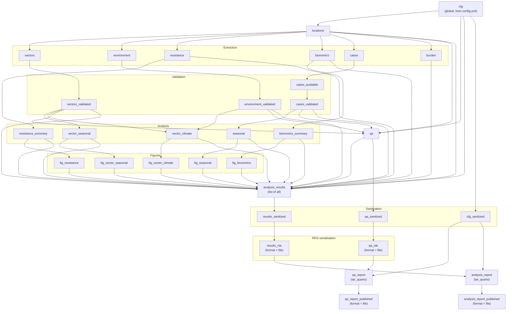

# Pipeline

The pipeline is defined in `_targets.R` at the project root. It is a
directed acyclic graph (DAG) of about 35 targets. `targets` runs only
what needs running, in the right order, and caches the rest on disk.

The pipeline is **vector-centred**: extraction and analysis of vectors,
environment, resistance, and bionomics all run unconditionally; case
data runs conditionally and does not block anything downstream.

---

## Running

```r
# Run everything that's out of date
targets::tar_make()

# Run one target and its dependencies
targets::tar_make(names = "fig_vector_climate")

# Run in-process (easier to debug; no child R sessions)
targets::tar_make(callr_function = NULL)
```

The first run will take several minutes. Subsequent runs are incremental.
The pipeline is safe to interrupt; `targets` commits each target's value
atomically, so an interrupted run leaves the cache consistent.

### A note on `read_cfg()` failures

`_targets.R` runs `read_cfg("study_name")` and similar calls at parse
time, before any target is defined. If a required key is missing from
the `vbd-cdm-analysis:` block in `config.yml`, `tar_make()` will error
before doing any work, with a message like:

```
Error: Required config key "study_name" not found in "vbd-cdm-analysis".
```

The **required** keys are read with `read_cfg()` and have no fallback:

```
study_name, start_year, end_year, env_variables, max_lag_months
```

The **optional** keys are read with `read_cfg_opt()` and return a default
on failure:

```
countries, locations, diseases,
include_estimated_cases, species_filter, output_dir
```

The `database:` block is read as a whole by `read_db_block()` and
resolved into `list(db_path, db_url)` by `resolve_database()`. A
malformed `postgres:` sub-block (missing `host`, `port`, `username`, or
`password`) produces a warning and falls back to `sqlite:` or
`DATABASE_URL`.

There is no `config::get()` path anywhere in the pipeline. The `config`
package is not used.

---

## Inspecting

```r
targets::tar_manifest()                # every target and its command
targets::tar_visnetwork()              # interactive DAG
targets::tar_progress()                # which targets ran / skipped / errored
targets::tar_outdated()                # what would run on next tar_make()
targets::tar_meta()                    # run times, warnings, errors, sizes
targets::tar_meta(fields = c("name", "time", "warnings", "error"))

targets::tar_load(analysis_results)    # load a target into the session
targets::tar_read(vectors)             # read a target without loading it
```

`tar_load()` requires `targets` to be attached. From a fresh session:

```r
targets::tar_load(analysis_results)
```

---

## Invalidating

```r
targets::tar_invalidate(seasonal)                    # force re-run of one target
targets::tar_invalidate(dplyr::everything())         # force re-run of everything
targets::tar_destroy()                               # wipe the cache
```

`targets` invalidates a target automatically when:

- the target's command changes (you edited the function it calls),
- any upstream target's value changes,
- any global that the target references changes (see *Config handling*
  below),
- the packages listed in `tar_option_set(packages = ...)` change.

It does **not** detect changes to the SQLite database. See *Database
invalidation* below.

---

## Target graph



The exhaustive dependency graph is available interactively via
`targets::tar_visnetwork()`. The diagram above shows the structure; the
tool shows the exact edges.

`cfg` is a **global**, not a `tar_target`. `targets` detects it as a
dependency of every target that references it, and hashes its value. See
*Config handling* below.

`fig_dir`, `data_dir`, and `rep_dir` are also globals (plain strings),
derived from `cfg$output_dir` at the top of `_targets.R` and created with
`dir.create()` before the pipeline is defined. They are passed as
arguments to the plot and report targets, so a change to `cfg$output_dir`
propagates through `cfg`'s hash — not through `fig_dir` directly.

---

## Target reference

### Extraction

| Target | Command | Notes |
|---|---|---|
| `locations` | `resolve_location_ids(countries = cfg$countries, locations = cfg$locations, db_path = cfg$db_path, db_url = cfg$db_url)` | Aborts on zero matches. Warns above 20. |
| `vectors` | `query_vectors(cfg, locations$location_id, species_filter = cfg$species_filter)` | Species filter is exact, case-insensitive. Aborts on unknown name. |
| `environment` | `query_environment(cfg, locations$location_id)` | Pivots long → wide. |
| `resistance` | `query_resistance(cfg, locations$location_id)` | Full width, including all VGSC counts and `source_code`. |
| `bionomics` | `query_bionomics(cfg, locations$location_id)` | |
| `cases` | `query_cases(cfg, locations$location_id)` | Excludes `'ESTIMATE'` rows unless `include_estimated_cases`. |
| `burden` | `query_burden(cfg, locations$location_id)` | |

Each query function calls `cdm_backend(cfg$db_path, cfg$db_url)` to
detect the SQL dialect and passes the result to `.loc_clause()` so the
JSON-array expansion uses the correct function
(`json_each` on SQLite, `jsonb_array_elements_text` on PostgreSQL).

### Validation

| Target | Behaviour |
|---|---|
| `vectors_validated` | Aborts the pipeline with `cli::cli_abort()` if `nrow(vectors) == 0`. Message includes the resolved location IDs and species filter. |
| `environment_validated` | Aborts with `cli::cli_abort()` if `nrow(environment) == 0`. Message includes the resolved location IDs and env variables. |
| `cases_available` | Boolean: `nrow(cases) > 0`. Consumed by the report. |
| `cases_validated` | Warns with `cli::cli_warn()` if empty, and returns `cases` unchanged. **Does not abort.** This is why the pipeline runs end-to-end on a database with no case data. |

### QA

| Target | Command |
|---|---|
| `qa` | `summarize_available_data(cases_validated, vectors_validated, environment_validated, locations, cfg)` |

`qa` is a pure function of its inputs (defined in `R/qa.R`), so its
output is cached and reusable by any downstream target or report.

### Analysis

| Target | Command |
|---|---|
| `vector_seasonal` | `analyze_vector_seasonal(vectors_validated)` |
| `vector_climate` | `analyze_vector_climate(vectors = vectors_validated, environment = environment_validated, climate_variables = cfg$env_variables, group_cols = c("species_name"), aggregation = "monthly", max_lag = cfg$max_lag_months, min_n = 5L, fdr_correct = TRUE)` |
| `resistance_summary` | `analyze_resistance(resistance)` |
| `bionomics_summary` | `analyze_bionomics(bionomics)` |
| `seasonal` | `analyze_seasonal(cases_validated)` |

Note that `resistance_summary` and `bionomics_summary` depend on the
**unvalidated** extraction targets. There is no `resistance_validated`
or `bionomics_validated`. This is intentional: an empty resistance
dataset should produce a `list(error = "...")` from `analyze_resistance`,
not abort the pipeline. The same applies to `seasonal` (via
`cases_validated`).

### Figures

| Target | Command |
|---|---|
| `fig_vector_seasonal` | `plot_vector_seasonal(vector_seasonal, cfg$study_name, fig_dir)` |
| `fig_vector_climate` | `plot_vector_climate(result = vector_climate, study_name = cfg$study_name, out_dir = fig_dir)` |
| `fig_resistance` | `plot_resistance(resistance_summary, cfg$study_name, fig_dir)` |
| `fig_bionomics` | `plot_bionomics(bionomics_summary, cfg$study_name, fig_dir)` |
| `fig_seasonal` | `plot_seasonal(seasonal, cfg$study_name, fig_dir)` |

Each returns a character vector of written file paths (invisibly). On
error, they warn and return `character()` — they never abort.

### Bundling and sanitisation

| Target | Purpose |
|---|---|
| `analysis_results` | A single list containing `cfg`, `locations`, all extraction outputs, all analysis results, all figure paths, `cases_available`, `cases_n`, and `qa`. This is what the report consumes. |
| `cfg_sanitized` | `sanitize_for_quarto(cfg)` — recursive `NA` replacement. |
| `qa_sanitized` | `sanitize_for_quarto(qa)`. |
| `results_sanitized` | `sanitize_for_quarto(analysis_results)`. |

### RDS serialisation

Two file targets serialise the sanitised parameter objects to disk:

| Target | Writes | `format` |
|---|---|---|
| `qa_rds` | `outputs/analysis/data/qa.rds` | `"file"` |
| `results_rds` | `outputs/analysis/data/analysis_results.rds` | `"file"` |

Both return the written path. They are then passed to `tar_quarto()` as
`execute_params`.

**Why RDS and not the objects directly.** Quarto's YAML 1.2 parameter
round-trip cannot faithfully serialise every R object. Simple lists of
tibbles usually survive, but nested structures (a `ggplot` grob, an
S4 object, a raw `call`) do not. Serialising to RDS and passing the file
path is robust, keeps the `targets` cache small, and lets the report
call `readRDS()` at the top of its setup chunk.

### Reports

| Target | Command |
|---|---|
| `qa_report` | `tar_quarto(path = "inst/report/qa_report.qmd", quiet = FALSE, execute_params = list(qa_path = qa_rds, cfg = cfg_sanitized))` |
| `qa_report_published` | Copies the rendered HTML from `inst/report/` into `outputs/analysis/reports/`. `format = "file"`. |
| `analysis_report` | `tar_quarto(path = "inst/report/analysis_report.qmd", quiet = FALSE, execute_params = list(cfg = cfg_sanitized, results_path = results_rds))` |
| `analysis_report_published` | Copies the rendered HTML from `inst/report/` into `outputs/analysis/reports/`. `format = "file"`. |

Both `tar_quarto` calls use `quiet = FALSE`, so Quarto's own output is
visible during `tar_make()`. This is deliberate — the render is the
slowest single step, and the progress lines are useful for spotting
early failures.

The `*_published` targets are what actually populate
`outputs/analysis/reports/`. `tar_quarto()` writes next to the source
`.qmd` by default (`inst/report/`); the publishing targets copy the
result to the output directory. If you only want the HTML in
`inst/report/`, drop the publishing targets.

---

## Config handling

`_targets.R` builds a single object, `cfg`, from `config.yml` at parse
time:

```r
db <- resolve_database(read_db_block())

cfg <- new_analysis_config(
  study_name              = read_cfg("study_name"),
  countries               = read_cfg_opt("countries"),
  locations               = read_cfg_opt("locations"),
  start_year              = read_cfg("start_year"),
  end_year                = read_cfg("end_year"),
  diseases                = read_cfg_opt("diseases"),
  include_estimated_cases = isTRUE(read_cfg_opt("include_estimated_cases", FALSE)),
  env_variables           = read_cfg("env_variables"),
  species_filter          = read_cfg_opt("species_filter"),
  max_lag_months          = read_cfg("max_lag_months"),
  db_path                 = db$db_path,
  db_url                  = db$db_url,
  output_dir              = {
    od <- read_cfg_opt("output_dir")
    if (is.null(od)) "outputs/analysis" else od
  }
)
```

### `cfg` is a global, not a target

`cfg` is a plain R object in `_targets.R`'s environment. It is **not** a
`tar_target()`. However, `targets` detects it as a dependency of every
target that references it, and hashes its value. So changing any key in
`config.yml` invalidates every target that reads `cfg` — which is nearly
all of them, including the extraction queries.

The practical consequence: changing `study_name` invalidates
`query_vectors`, `query_environment`, `query_cases`, and the rest, even
though `study_name` has no effect on the SQL. On a large database this
turns a 30-second re-run into a 30-minute one.

If this becomes a problem, the fix is to make `cfg` an explicit target:

```r
tar_target(cfg, new_analysis_config(...))
```

...and then split it into per-consumer targets (`cfg_study_name`,
`cfg_env_variables`, `cfg_db_path`, ...) so `study_name` invalidates
only the plot targets. Neither change is currently made.

### Three config accessors

Defined in `R/config.R`:

- **`read_cfg(key)`** — reads from the `vbd-cdm-analysis:` block. Aborts
  with a `cli::cli_abort()` if the key is missing. Used for the five
  required keys.
- **`read_cfg_opt(key, default = NULL)`** — returns `default` if the key
  is missing or the block is absent. Used for the six optional keys.
- **`read_db_block()`** — returns the entire `database:` block (or
  `NULL`). The result is passed to `resolve_database()`, which returns
  `list(db_path, db_url)`.

### `normalize_all_list()`

YAML `[]` becomes an R `list()` with `length == 0`, and
`as.integer(list())` or `toupper(list())` would error downstream. The
`normalize_all_list()` helper in `R/config.R` handles this:

```r
normalize_all_list <- function(x) {
  if (is.null(x)) return(NULL)
  if (is.list(x) && length(x) == 0) return(NULL)
  vals <- unlist(x, use.names = FALSE)
  if (length(vals) == 0) return(NULL)
  vals <- trimws(as.character(vals))
  vals <- vals[nzchar(vals)]
  if (length(vals) == 0) return(NULL)
  lower <- tolower(vals)
  all_tokens <- c("all", "any", "*")
  if (all(lower %in% all_tokens)) return(NULL)
  if (any(lower %in% all_tokens)) {
    cli::cli_abort(c(
      "Cannot mix 'ALL' with explicit values in the same list.",
      "i" = "Use either `[\"ALL\"]` or a list of specific values, not both."
    ))
  }
  vals
}
```

It is applied inside `new_analysis_config()` to `countries`, `locations`,
and `diseases`. A `NULL` return means "no filter" for that dimension.

### `resolve_database()`

Also in `R/config.R`. Takes the raw `database:` block and returns
`list(db_path = ..., db_url = ...)`:

1. If `postgres:` is present and complete (`host`, `port`, `username`,
   `password`; `dbname` defaults to `"vbd_cdm"`), builds a
   `postgresql://user:pw@host:port/dbname` URL. `db_url` is set;
   `db_path` is `NULL`.
2. Otherwise, if `sqlite:` is present with a non-empty `db_path`, that
   path is returned. `db_url` is `NULL`.
3. Otherwise, if `DATABASE_URL` is set in the environment, it becomes
   `db_url`.
4. Otherwise, both are `NULL`, and `cdm_connect()` falls back to
   `SQL_LITE_DB_NAME`.

Normalises the raw YAML in two shapes: a plain dict (`sqlite: {db_path: …}`)
and a list of single-key dicts (`sqlite: [{db_path: …}]`). Both forms
are accepted.

---

## Extending

### Adding a new analysis

1. **Write a pure function** in `R/`. It takes tibbles, returns a tibble
   or list. It must not read files, connect to the DB, call `Sys.time()`,
   or use unseeded randomness.

   ```r
   # R/analysis_trend.R
   analyze_trend <- function(vectors) {
     if (is.null(vectors) || nrow(vectors) == 0) {
       return(list(error = "No vector data available."))
     }
     monthly <- vectors |>
       dplyr::mutate(month = lubridate::floor_date(date, "month")) |>
       dplyr::group_by(month) |>
       dplyr::summarise(n = sum(count, na.rm = TRUE), .groups = "drop")
     fit <- stats::lm(n ~ as.numeric(month), data = monthly)
     list(monthly = monthly, slope = unname(stats::coef(fit)[2]), error = NULL)
   }
   ```

2. **Write a plot function** if the result should be visualised. Same
   contract: pure, takes the analysis result plus `study_name` and
   `out_dir`, returns the written file path(s) invisibly. Use
   `theme_cdm()` and `cdm_palette` from `plot_helpers.R` for consistency.

3. **Add targets** to `_targets.R`, in the analysis section:

   ```r
   tar_target(trend, analyze_trend(vectors_validated)),
   ```

   ...and in the figures section:

   ```r
   tar_target(fig_trend, plot_trend(trend, cfg$study_name, fig_dir)),
   ```

4. **Add the results** to the `analysis_results` bundle so the report
   can access them:

   ```r
   tar_target(
     analysis_results,
     list(
       ...,
       trend     = trend,
       fig_trend = fig_trend
     )
   ),
   ```

   The bundle is a hard-coded list; new fields do not appear
   automatically. Because `results_sanitized` and `results_rds` depend
   on `analysis_results`, adding a field here automatically propagates
   to the report parameter.

5. **Add a section** to `inst/report/analysis_report.qmd`, following the
   pattern of the existing sections:

   ````markdown
   ## Trend

   ```{r}
   tr <- res$trend
   if (!is.null(err_of(tr))) {
     note("Trend analysis did not run: ", err_of(tr))
   } else {
     tr$monthly |> gt::gt() |> gt::tab_header(title = "Monthly counts")
   }
   ```

   ```{r, fig.width=12, fig.height=5}
   p <- res$fig_trend
   if (is.character(p) && length(p) >= 1 && file.exists(p[1])) {
     knitr::include_graphics(p[1])
   } else {
     note("No trend figure available.")
   }
   ```