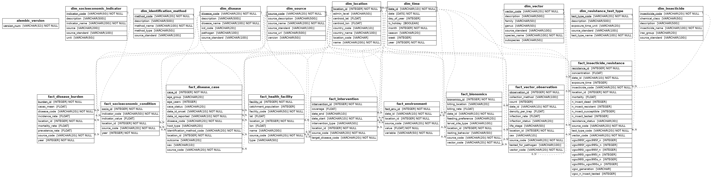

Data model
==========

.. _erd:

Entity-relationship diagram
----------------------------

   The CDM at a glance. Dimensions are white; facts are grey.

   Regenerate with ``python generate_er_neo.py``.

Layout
------

The CDM is a **star-schema** warehouse:

* **Conformed dimensions** - shared across many facts.
* **Domain facts** - one per observation family.
* **Bridge** - ``fact_concept_map`` for vocabulary standardisation.

.. list-table:: Dimensions
   :header-rows: 1
   :widths: 25 20 55

   * - Table
     - PK
     - Notes
   * - ``dim_time``
     - ``date_id``
     - Pre-populated 1900-01-01 ... 2026-12-31 by ``main.init_dim_time()``.
   * - ``dim_location``
     - ``location_id``
     - Autoincrement. ``location_code`` is the natural key. Grid cells carry ``admin_level = 'grid'``.
   * - ``dim_source``
     - ``source_code``
     - Provenance. Every fact row carries one.
   * - ``dim_vector``
     - ``vector_code``
     - Species/subspecies. Joined to facts via ``vector_code``.
   * - ``dim_disease``
     - ``disease_code``
     - ICD-10 aligned where possible.
   * - ``dim_insecticide``
     - ``insecticide_code``
     - IRAC group where possible.
   * - ``dim_identification_method``
     - ``method_code``
     - ``'ESTIMATE'`` is the synthetic-method code.
   * - ``dim_resistance_test_type``
     - ``test_type_code``
     - WHO tube, CDC bottle, ...
   * - ``dim_socioeconomic_indicator``
     - ``indicator_code``
     - World Bank indicator codes, e.g. ``SP.POP.TOTL``.
   * - ``dim_vocabulary``, ``dim_concept``
     - ``vocabulary_id`` / ``concept_id``
     - External vocabularies (GADM, IDOMAL, NCBI, MIRO).

.. list-table:: Facts
   :header-rows: 1
   :widths: 35 20 45

   * - Table
     - PK
     - Cardinality vs. dimensions
   * - ``fact_vector_observation``
     - ``observation_id``
     - ↔ ``dim_location``, ``dim_time``, ``dim_vector``, ``dim_source``
   * - ``fact_environment``
     - ``fact_env_id``
     - ↔ ``dim_location``, ``dim_time``, ``dim_source``
   * - ``fact_insecticide_resistance``
     - ``resistance_id``
     - ↔ ``dim_location``, ``dim_time``, ``dim_vector``, ``dim_insecticide``, ``dim_resistance_test_type``, ``dim_source``
   * - ``fact_bionomics``
     - ``bionomics_id``
     - ↔ ``dim_location``, ``dim_time``, ``dim_vector``, ``dim_source``
   * - ``fact_disease_case``
     - ``case_id``
     - ↔ ``dim_location``, ``dim_time`` (×2: onset, reported), ``dim_disease``, ``dim_identification_method``, ``dim_source``
   * - ``fact_disease_burden``
     - ``burden_id``
     - ↔ ``dim_location``, ``dim_disease``, ``dim_source``. Yearly.
   * - ``fact_intervention``
     - ``intervention_id``
     - ↔ ``dim_location``, ``dim_time`` (×2), ``dim_disease``, ``dim_source``
   * - ``fact_socioeconomic_condition``
     - ``socio_id``
     - ↔ ``dim_location``, ``dim_socioeconomic_indicator``, ``dim_source``. Yearly.
   * - ``fact_health_facility``
     - ``facility_id``
     - ↔ ``dim_location``, ``dim_source``

Full schema
-----------

.. autosummary::
   :toctree: generated
   :nosignatures:

   database.models.DimTime
   database.models.DimLocation
   database.models.DimSource
   database.models.DimVector
   database.models.DimDisease
   database.models.DimInsecticide
   database.models.DimIdentificationMethod
   database.models.DimResistanceTestType
   database.models.DimSocioeconomicIndicator
   database.models.FactVectorObservation
   database.models.FactEnvironment
   database.models.FactInsecticideResistance
   database.models.FactBionomics
   database.models.FactDiseaseCase
   database.models.FactDiseaseBurden
   database.models.FactIntervention
   database.models.FactSocioeconomicCondition
   database.models.FactHealthFacility